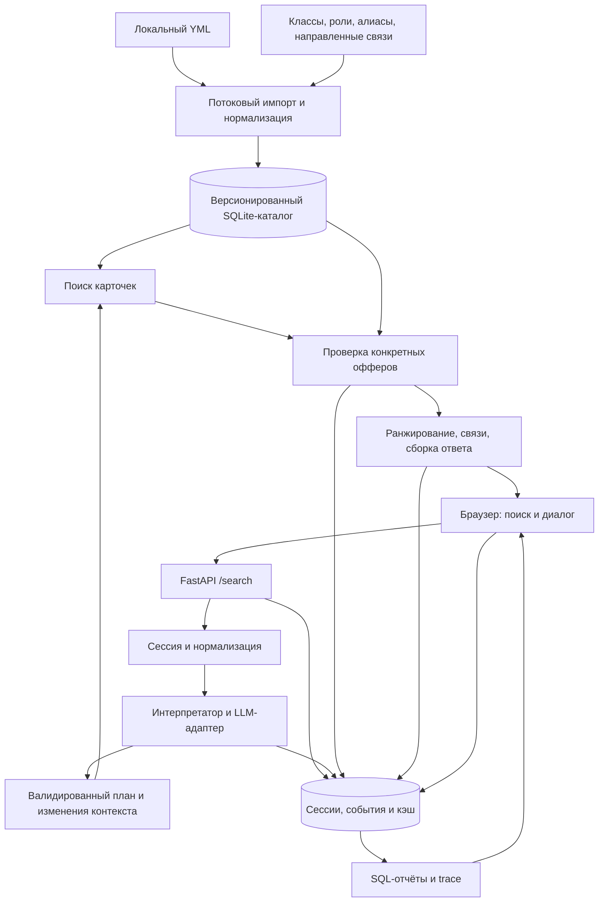

# Архитектура MVP «Умный поиск на сайте»

Версия 1.0 · 27.11.2026 · проектное решение для реализации, не отчёт о работающей системе.

## 1. Основания и статус

Прочитаны `AGENTS.md`, `ORCHESTRATOR.md`, `TZ.md`, `REQUIREMENTS.md`, `RESEARCH_REPORT.md`, `REUSE_POLICY.md`, `REFERENCE_PROJECT.md` и задание пользователя. Последние 19 согласованных решений из задания уточняют устаревшие положения требований. Исходные документы не изменены. Контракты определены в [CONTRACTS.md](CONTRACTS.md), работы и приёмка — в [IMPLEMENTATION_PLAN.md](IMPLEMENTATION_PLAN.md).

`RESEARCH_REPORT.md` появился в рабочей области в ходе подготовки и полностью прочитан перед завершением. Решения сверены с его §1–10 без повторного анализа фида и донора. Общая статистика взята из ТЗ и отчёта; точные офферные примеры для приёмки — из §8 отчёта. По последнему сообщению организатора окончательный срок приёма работ — **28.11.2026, 12:00 МСК**. Неопределёнными остаются условия исключения из минимума четырёх товаров, навигационные запросы, закрытые Q&A и права публикации данных.

Цель: один демонстрационный сервис, который понимает потребность, показывает реальные карточки и подходящие офферы, объясняет ограничения и даёт бизнесу аналитику запросов. Около 500 запросов/сутки — исходное допущение из ТЗ, а не измеренная нагрузка.

## 2. Принятый стек

| Область | Решение | Основание и отвергнутая альтернатива |
|---|---|---|
| Backend | Python 3.12+, FastAPI, Uvicorn, Pydantic 2 | Совместимо с существующим `pyproject.toml`; один язык для загрузки, поиска, API и отчётов. Отдельные микросервисы не нужны |
| Frontend | HTML/CSS и нативные JS modules, `fetch`, раздача из FastAPI | Три экрана: поиск, trace, аналитика. Без Node-сборки и React ради сокращения интеграции |
| Каталог | `data/catalog/<catalog_version>/catalog.sqlite`, неизменяемый после сборки | Около 12 538 карточек и 136 040 офферов по ТЗ. PostgreSQL/Elasticsearch не дают необходимого MVP выигрыша |
| Индексы | SQLite FTS5 `unicode61`; B-tree для идентификаторов, вендора, класса, ролей и `offers.card_id`; RapidFuzz для названий/алиасов | Точный поиск, BM25 и опечатки без отдельного сервера. Морфологию русского языка FTS5 не обеспечивает; её недостаток покрывают нормализация, алиасы и LLM |
| Контекст, события, кэш | `data/runtime/state.sqlite`, стандартный rollback journal, `busy_timeout=5000`, короткие транзакции | Один процесс и небольшой поток записей; Redis и очередь задач не нужны. Сетевые обращения выполняются вне транзакций |
| Runtime LLM | OpenAI Responses API, `gpt-5.4-mini-2026-03-17`, один адаптер на `httpx` | `reasoning.effort=none` для интерпретации, `low` для экспертного плана. Одна модель упрощает интеграцию; назначенные агентам Sol/Astra/Terra относятся к разработке, не runtime |
| Ответ | Детерминированный сборщик из проверенных результатов | Дополнительная LLM для красивого текста увеличивает задержку и риск вымышленных фактов |
| Логи | Структурированные события в SQLite + JSON в stdout через стандартный `logging` | Таблица событий — источник аналитики; stdout — технический вывод, не второй обязательный журнал |
| Аналитика | SQL-агрегаты, API `/api/v1/analytics`, HTML-страница `/analytics` | Без отдельного Streamlit, BI-сервера и ETL-сервиса |
| Запуск | Один Uvicorn worker; локально Python venv, стенд — один Docker-контейнер на Linux VM с локальным диском | Без Kubernetes, Celery и отдельной СУБД. Публичное размещение — отдельное действие после разрешения |

P0 проверил запасной маршрут через Yandex AI Studio Responses API. OpenAI вернул HTTP 429. YandexGPT Pro 5.1 обработал русскоязычные функциональный и экспертный запросы на реальном каталоге и вернул usage. Провайдер выбирается явно через `SSS_LLM_PROVIDER`. Для точного URI `yandexgpt-5.1` применяется стандартный синхронный тариф в рублях с НДС. Для калькулятора сдачи требуется сумма без НДС. [Модели AI Studio](https://aistudio.yandex.ru/ru/docs/ai-studio/concepts/generation/models), [тарификация AI Studio](https://aistudio.yandex.ru/ru/docs/ai-studio/pricing).

FastAPI умеет раздавать статические файлы — это позволяет использовать один origin для интерфейса и API ([официальная документация](https://fastapi.tiangolo.com/tutorial/static-files/)). Возможности FTS5, Unicode-токенизатора и BM25 описаны в [документации SQLite](https://www.sqlite.org/fts5.html). WAL не требуется для MVP; при последующем переходе на WAL нужно учитывать версию SQLite и исправления, описанные в [документации WAL](https://www.sqlite.org/wal.html).

Выбранная модель поддерживает Structured Outputs и указанные уровни reasoning; snapshot и базовые тарифы проверены по [странице GPT-5.4 mini](https://developers.openai.com/api/docs/models/gpt-5.4-mini). Это подтверждает интерфейс модели, **не доступность API для аккаунта команды**. Наличие разрешённого аккаунта, ключа, бюджета и доступа со стенда — допущение A1, проверяемое первым интеграционным smoke. Замена провайдера затрагивает только адаптер и тарифы; молча менять модель или считать локальные правила полноценной заменой LLM нельзя.

Точные версии Python-пакетов фиксируются оркестратором при первом воспроизводимом запуске. Сейчас зависимости не установлены и продукт не реализуется.

## 3. Компоненты и поток данных



Браузер отправляет пользовательские события в API, а не пишет в БД напрямую. LLM не выполняет SQL, не управляет сетью и не обращается к каталогу инструментами: приложение передаёт ей краткую таксономию, контекст и текущую реплику. Все идентификаторы и значения проверяются приложением.

Модули внутри `src/smart_site_search/`: `contracts`, `catalog`, `interpretation`, `session`, `search`, `response`, `telemetry`, `analytics`, `api`, `static`. Межмодульный обмен — типизированные объекты из `contracts`. Сервисный координатор живёт в `service.py`; отдельный агентный фреймворк не нужен.

## 4. Каталог и происхождение данных

### 4.1. Единицы хранения

**SoftwareCard:** `card_id=group:<group_id>`, имя категории, соответствующей группе, список вендоров, `shelf_ids`, один основной `class_id` и несколько `role_ids`, перечни встреченных характеристик, агрегаты количества офферов и цен. Только группы с офферами. Полка `categoryId` не является карточкой.

**HardwareCard:** `card_id=offer:<offer_id>`, имя конкретного устройства, вендор, класс, роли и один `offer_id`. Его свойства не смешиваются с соседними моделями устройств.

**Offer:** одна исходная позиция; `offer_id` — строка исходного id, `card_id`, исходное имя, URL, изображение, артикул, цена, валюта, наличие, условия партии, нормализованные характеристики и исходные `param`. Детерминированно извлечённое из названия условие тоже допустимо с source ref на название: например, x86_64 и бессрочность у оффера `495106` в §8 отчёта. При конфликте названия и param — unknown/conflicting, не произвольный выбор источника.

Решение в отличие от предложения `TZ.md §8`: таблица `offers` содержит **и софт, и оборудование**. Для оборудования связь один-к-одному и join по id, без этапа подбора лицензии. Это устраняет два разных алгоритма проверки цены, неизвестных значений и доказательств при небольших дополнительных 8 125 строках. В интерфейсе оборудование остаётся одной карточкой.

### 4.2. Таблицы и индексы

| Таблица | Минимальное содержание и индексы |
|---|---|
| `catalog_meta` | Версии схемы/нормализатора/таксономии, SHA-256 источника, дата фида, сборка и счётчики |
| `cards` | PK `card_id`, kind, name, vendor(s), class_id, описание, URL изображения, агрегаты; индекс class_id |
| `offers` | PK offer_id, FK card_id, price_minor, currency, available, url, sales_notes, raw_params_json, attrs_json; индекс `(card_id, available, price_minor)` |
| `offer_attr_values` | offer_id, key, typed_value, unit, knowledge, raw_index; индекс `(offer_id, key)`; типовые числовые поля также в нормализованных колонках offers |
| `card_roles` | `(card_id, role_id)` + provenance; индекс `(role_id, card_id)` |
| `aliases` | norm_text, target_type, target_id, provenance; индекс norm_text |
| `classes`, `roles` | Короткие определения, допустимый kind; стабильные строковые id |
| `relations` | Направленная связь классов/ролей, причина, применимые фильтры, происхождение |
| `cards_fts` | card_id UNINDEXED, name, vendor, aliases, roles_text, description; FTS5 |

Поля со свободным JSON не заменяют индексы для основных путей. FTS перестраивается при сборке immutable-каталога. Параметры SQL связываются, FTS-выражение строится из экранированных токенов, а не из сырой строки пользователя.

### 4.3. Нормализация

- Сохранять `raw_params` как **список** `{name,value,index}`, а не словарь: повторяющиеся имена нельзя потерять. Многозначные свойства сохраняются множествами, точные дубли удаляются только в нормализованном представлении.
- Пустые строки, «другое или отсутствует», «не определено» дают `unknown`. Противоречащие значения одиночного свойства дают `conflicting`; при проверке это недостаток данных, не удобное значение на выбор. `Назначение` разделяется по контролируемым смысловым полям, не объединяется в одно обещание.
- Цена через `Decimal` переводится в целые копейки; `RUR` нормализуется в `RUB`, исходное обозначение сохраняется. Нулевая цена → `price_minor=null`, `price_state=on_request`. Не представлять товар бесплатным. Другие валюты не конвертировать без заданного курса.
- `available` — независимое `true/false/null`, а не вывод из цены. В UI всегда «по фиду от …», не онлайн-остаток. Доступный оффер без цены не доказывает бюджетное соответствие.
- Срок — количество месяцев, если однозначно; бессрочность — отдельное значение. Память — GiB/GB с сохранением исходной единицы; нельзя молча считать их одинаковыми. Количество пользователей, устройств, узлов и процессорных ядер — разные поля.
- Диапазон «10–50 пользователей» хранится как интервал с типом: лицензионный диапазон, ёмкость пакета или допустимая партия — разные вещи. Стоимость за требуемое количество рассчитывается только при подтверждённой модели единицы продажи, размере пакета и границах партии. Иначе показывается цена оффера с оговоркой, total=null; «на 50 компов» само по себе не разрешает умножить любую цену на 50. В частности, партия 50–99 у `222175` не является ценой пакета на 50 устройств.
- `sales_notes` сохраняется полностью; известные шаблоны партии разбираются правилами, остальные остаются unknown. Не делать LLM-фактом условие закупки.
- Перечни характеристик карточки служат навигации и предварительному отбору. Они никогда не доказывают существование комбинации лицензии.
- Отечественное происхождение по полке — `domestic_hint` с источником category; это не номер реестра и не подтверждение сертификации. Требование «из реестра российского ПО» проверяется отдельным фактом, при его отсутствии — unknown.
- Исходный URL оффера допустим для перехода. Красивый адрес карточки не строится эвристически из имени. При отсутствии подтверждённого card_url — подпись «Перейти к варианту лицензии».

### 4.4. Обогащение и повторный запуск

1. CLI читает явно заданный путь фида; сейчас файл обнаружен в корне проекта, а указанный в старом ТЗ путь `docs/Mindbox.yml.gz.xml` отсутствует. Не запускать существующий extractor с ошибочным default path.
2. Потоковый разбор XML без загрузки внешнего DTD/сущностей, очистка обработанных узлов. Сборка во временную БД, проверка ссылок/чисел/дубликатов; никакого сканирования XML на запросе.
3. Версионируемые JSON-справочники: shelf→class, роли и определения, синонимы, связи. Широкие полки «Серверное ПО»/«Другие программы» не дают карточке конкретную функцию автоматически. Отчёт §2 также выявил ROSA Dynamic Directory на полке «Российская виртуализация»: такая полка не подтверждает роль гипервизора. Стартовые роли включают `server_os`, `hypervisor`, `backup_restore`, `gpu`, `nas`, `ups`, `endpoint_security`. Неразобранная карточка получает `class_id=unclassified` и остаётся доступна по имени.
4. Начать с правил по имени, полке и существующим атрибутам. LLM готовит предложение небольшого справочника ролей/алиасов/связей и обрабатывает только неоднозначные группы карточек пакетами до 20; максимум 200 карточек в первом цикле. Человек/агент проверяет присвоения по доступным данным. Не обогащать 136 тысяч офферов индивидуально.
5. Роль, назначенная только по знаниям LLM, имеет `provenance=llm_hypothesis`. Она помогает recall, но требует оговорки; в полном соответствии функции участвуют роли с подтверждающим фрагментом источника или проверенным правилом классификации. Семантическая метка не подтверждает характеристики или совместимость.
6. Результаты обогащения сохраняются по ключу `(card_fingerprint, taxonomy_version, prompt_version, model)`. При обновлении фида переиспользуются только неизменившиеся карточки. Манифест содержит расходы офлайн-вызовов отдельно от runtime.
7. `catalog_version` — хэш фида + версии нормализации + утверждённых семантических артефактов. После проверки — переключение указателя на готовую версию. Работающий процесс использует один snapshot до перезапуска. При старте — открытие готовой БД, без импорта, LLM-обогащения и платных операций.

Общие ожидаемые числа из ТЗ: 4 413 + 8 125 карточек, 136 040 офферов. Это контроль для данного snapshot; любое расхождение объясняется, а не подгоняется фильтрацией под число. `data/product_cards.jsonl` с вложенными лицензиями не является runtime-индексом.

## 5. Поиск и маршрутизация

### 5.1. Одна реплика

1. Принять `client_request_id`, проверить длину, загрузить сессию и её revision, записать `request_received`.
2. Нормализовать Unicode, регистр, пробелы, ё/е в поисковом представлении; сохранить оригинал. Исправления раскладки, транслитерация и алиасы — дополнительные варианты, не перезапись пользовательского намерения. Цифры версии/артикула не исправлять fuzzy-алгоритмом.
3. Если это однозначное точное имя/артикул без непрочитанных условий — direct fast path. Если остались слова, ограничения, контекстная ссылка или описание задачи — LLM-интерпретация обязательна. Запрос «Astra на год» не считается просто точным именем.
4. Валидировать структуру интерпретации, ссылки на роли/классы, фильтры и операции изменения контекста. Применить reducer сессии; в экспертном режиме получить отдельный ограниченный план компонентов.
5. Получить кандидатов из точных идентификаторов/алиасов, FTS, fuzzy и индекса ролей. Объединить по card_id; сохранить происхождение каждого попадания.
6. Проверить условия на офферах выбранных карточек, разделить full/partial/rejected. При недостатке full — расширить поиск по правилам ниже.
7. Ранжировать, выбрать карточки, добавить проверенные связанные товары, сформировать вопрос и предложения по уточнению.
8. Атомарно записать итог, новую сессию и `response_completed`; вернуть ответ. UI отправляет `results_impression` только после фактического отображения.

### 5.2. Три режима

| Режим | Задача LLM и поиска |
|---|---|
| direct | Найти продукт/вендора/артикул, извлечь лицензионные условия. Для однозначной сущности допустимо 0 LLM-вызовов |
| functional | Преобразовать новую формулировку в цель, роли, классы, поисковые термины и фильтры; 1 интерпретация |
| expert | Интерпретатор определяет сложную многокомпонентную задачу; второй вызов составляет до 4 функциональных компонентов и вопросов; каждый компонент ищется обычным ядром |

Без embeddings функциональный запрос работает так: фраза «после сбоя вернуть рабочие файлы и машины» не обязана совпасть с названием товара; LLM выбирает `backup_restore`, формирует «резервное копирование», «backup», «восстановление», возможно уточняет тип окружения. Индекс ролей возвращает карточки независимо от буквального запроса, а расширенный FTS ловит карточки без назначенной роли. Свободные поисковые термины разрешены, неизвестные role_id — нет. При отсутствии подходящей роли интерпретатор возвращает `unmapped_need`, термины и уточнение. Новая формулировка не добавляется в ручной словарь как специальный ответ.

Embeddings и векторная БД **не входят в MVP**. Критерий качества — приёмка новых перефразировок и фактическая релевантность, а не само наличие вектора. Если recall недостаточен, сначала исправить маппинг ролей/обогащение и разбор запроса. Добавление векторов — отдельное решение после доказанного провала этого подхода, не скрытая обязательная зависимость.

### 5.3. Кандидаты и полнота

- Первая страница — до 24 карточек. Квоты резервируют кандидатов из точного канала, ролей и FTS/fuzzy, чтобы один канал не вытеснил остальные. Дубли удаляются, пустая квота передаётся другим каналам.
- RapidFuzz `WRatio` применяется к словарю имён/вендоров/алиасов, загруженному из каталога. Стартовый порог 85/100, до 8 fuzzy-кандидатов; точные имена выше исправленных. Это настраиваемый порог, не доказанная точность.
- При необходимости расширять пул с 24 до 72, затем до 200 уникальных карточек. Для direct достаточно уверенно найти запрошенный товар. Для functional поводом служит нехватка качественных кандидатов, для expert — слабое покрытие отдельных компонентов. Само по себе количество full меньше четырёх расширение не запускает. Для expert общий бюджет 200, стартовая квота до 50 на компонент.
- Проверка офферов ограничивается `card_id` кандидатов. SQL `EXISTS`/ранжирование подходящих офферов использует все офферы **данной карточки**, а не первые N дешёвых строк. В приложение возвращаются лучший full и до 2 лучших partial-свидетелей. Нет глобального перебора всех офферов фида.
- Вторая страница кандидатов обязана находить подходящую лицензию, пропущенную первой. Достижение лимита 200 или времени помечается `search_truncated=true`; говорить «в каталоге точно нет» при этом нельзя.
- Расширение recall: дополнительные валидированные термины интерпретации, другие роли той же задачи, альтернативные продукты в релевантном классе. Ослабление условий **не удаляет** исходный фильтр из проверки: нарушение показывается как partial. Нельзя ослаблять `exclude`, менять оборудование на ПО или выдумывать функцию ради количества.
- Запрос дополнительных вариантов исключает уже показанные карточки из новой основной выдачи; исчерпание текущей выборки описывается отдельно от отсутствия товара.

Полная глобальная top-k оптимальность не обещается. Приёмка проверяет полноту на специально выбранном случае за пределами первой страницы и честную маркировку предела поиска.

### 5.4. Соответствие и ранжирование

Для каждого условия: `match`, `mismatch`, `unknown`, включая причину и source ref. Карточка `full`, только если релевантна основной потребности и один конкретный оффер подтверждает все `require`-условия. Отсутствие обязательных фильтров не требует выдумывать свойства: достаточно подтверждённой идентичности/функции и выбранного реального оффера; неизвестные цена/наличие всё равно видимы.

Явно запрошенный продукт/артикул — обязательное условие идентичности, а не только повышающий score. Другой продукт того же класса не становится full. В запросе «аналог VMware» VMware — reference entity, не обязательный vendor/card фильтр; предложение альтернатив проверяется по функции. Интерпретатор обязан различать target/reference/excluded сущности.

`partial` — релевантный продукт с неподтверждённой функцией или с mismatch/unknown обязательного условия. Исключённый пользователем товар/вендор — `rejected`, не partial. `prefer` влияет на порядок, но не на full/partial. Для отрицательного условия с неизвестным значением нельзя заявить подтверждённое исключение нежелательного свойства: unknown остаётся partial.

Порядок: группа full выше partial; внутри — подтверждённость потребности, точность сущности/функции, число выполненных предпочтений, наличие выбранного оффера, известная применимая цена, затем стабильный card_id. Популярность и маржа служат только последним tie-break при одинаковой релевантности; отсутствующие данные дают нейтральный вклад. Mock-факторы включаются отдельным демонстрационным переключателем и явно маркируются.

Цена карточки в ответе вычисляется по офферам, соответствующим текущим условиям. Если выбрана partial-лицензия, её цена подписана как цена альтернативного варианта с перечисленными отклонениями. Общий min/max продукта нельзя выдать за стоимость требуемой конфигурации.

### 5.5. Связанные товары и четыре карточки

Статический направленный справочник: например, `server_hardware → server_os`, `server_hardware → hypervisor`, `server_hardware → ups`, `server_hardware → backup_restore`, `operating_system → endpoint_security`. Ребро содержит применимые фильтры, обоснование и provenance. Направление не обращается автоматически. В соответствии с §3 отчёта LLM предлагает связь, затем её назначение проверяется по документации вендора и существующим товарам; URL документа и проверенный фрагмент сохраняются. Это небольшая проверка справочника при реализации, не повторное исследование каталога. Непроверенное ребро в штатной выдаче не используется.

Фильтры лицензии основного продукта не копируются на дополнение. Общие запреты вендора/товара действуют; ограничения платформы или организации передаются только по явно указанной области применимости связи. Бюджет одной лицензии не становится бюджетом комплекта.

Ответ содержит три отдельные группы: **основные полные**, **основные частичные**, **связанные**. Цель — минимум четыре уникальные обоснованные карточки суммарно в штатном сценарии; верхний предел по умолчанию 8. Добор: full → partial с оговорками → related с причиной. При меньшем числе — `insufficient_relevant_items=true` и объяснение. Это явно задокументированное ограничение выполнения официального минимума, не утверждение о согласованном организатором исключении.

Если основного результата нет, связанные позиции могут быть показаны только при понятной потребности и проверенной связи; `primary_outcome` при этом остаётся `none`. Связь означает функциональное дополнение, не аппаратную/лицензионную совместимость и не «часто покупают вместе».

## 6. Сессия и экспертный режим

### 6.1. Состояние и изменения

Хранить текущую цель, режим, тему, активные условия с происхождением, исключения, последние два набора результатов с порядком, до 200 показанных card_id текущей темы, последний экспертный план. Не отправлять модели полный чат; передавать это состояние, текущую реплику и последние две пары реплик с ограничением длины. TTL сессии — 24 часа, явная кнопка новой сессии.

Reducer применяет `set`, `remove`, `clear_scope`; `set` заменяет прежнее значение по `(scope, component_id, key)`. «Не дороже 30 тысяч» заменяет бюджет, «без ограничения цены» его удаляет. Явный текущий ввод выше сохранённого контекста, mock-профиль ниже текущих фильтров.

«Второй» разрешается по `reference_request_id` и сохранённому display order, а не по новому ранжированию. «Ещё» сохраняет потребность и фильтры, увеличивает seen-set. «Кроме этого вендора» добавляет исключение через выбранную карточку. При новой теме очищаются фильтры темы/компонентов, ссылки и seen-set; сохраняются только явно объявленные session-ограничения. Фраза «на год для юрлица» не должна перейти на ноутбук как лицензионный фильтр. Неоднозначная ссылка вызывает уточнение без произвольного изменения состояния.

### 6.2. Экспертный план

LLM возвращает 1–4 компонента: роль, задача, обязательность компонента, поисковые термины, условия, предположения, недостающие сведения. При большем scope — явно обозначить границу и задать вопрос. Например, для локальной LLM это могут быть вычислительный узел, ОС, резервное копирование; GPU/память не назначаются как достаточные без размера модели, нагрузки и измерений.

Поисковое ядро независимо заполняет каждый компонент фактическими карточками/офферами. Сборщик показывает статусы `covered`, `partial`, `missing`. `covered` означает найденную подтверждённую функциональную роль и условия, **не совместимость целого решения**. Требуемый компонент без full-результата исключает статус полного покрытия задачи. Варианты одного компонента не суммируются как комплект; общей цены решения в MVP нет.

Текст экспертного плана выводится как предположение. Лицензионные, ценовые и аппаратные факты в товарных блоках берутся только из валидированных source refs. Отдельный compatibility_status по умолчанию `not_verified`.

### 6.3. Лимиты и отказ LLM

На пользовательский запрос максимум 2 фактические попытки обращения к модели: 1 интерпретация + 1 экспертный план либо 1 интерпретация + 1 повтор после временной ошибки. Нельзя получить третью попытку через SDK retry. Общий deadline 25 секунд, LLM — до 18 секунд суммарно; локальный поиск — ориентир до 2 секунд. Это инженерные бюджеты, проверяемые измерениями, не SLA. Ответ модели ограничен 2 000 output tokens для интерпретации и 4 000 для экспертного плана; учитываются все оплачиваемые output tokens.

Структура — JSON Schema + Pydantic, дополнительные поля запрещены. Ошибка структуры/усечённый ответ/отказ/неизвестный id не исполняются. При 401/403 повтор не делать; при 429/5xx возможен один повтор, только в оставшемся бюджете. Circuit breaker в памяти: после 3 последовательных технических отказов отключить новые вызовы на 60 секунд; это настройка MVP.

Кэш валидированной интерпретации keyed by нормализованная реплика + hash состояния + taxonomy/prompt/model versions; TTL 1 час. Не кэшировать финальные цены отдельно от версии каталога. Кэш экспертного плана зависит от тех же входов; его использование явно видно в trace, новых LLM-расходов нет.

При отказе: exact/FTS/fuzzy и известные роли продолжают работать; доказуемые простые фильтры применяются, непонятная часть реплики отражается как `unresolved_constraints` и запрещает маркировку full. Для новой сложной потребности — честный статус `degraded`, полезные имеющиеся результаты и вопрос. Сохранённый совместимый план той же темы допустимо использовать с маркировкой; новый экспертный план не симулируется. Mock-ответ провайдера разрешён только в тестах и обозначенном demo replay, который не считается live-приёмкой.

## 7. Логирование, аналитика и экономика

События и точные поля заданы в CONTRACTS.md. На первом инкременте записываются запрос, интерпретация, операции контекста, стадии retrieval/verification, итог, ошибки, каждый реальный вызов модели и пользовательские показы/клики. Не записывать chain-of-thought, ключи, полный сырой feed и персональные данные. Краткая интерпретация — наблюдаемый результат модели, не её скрытые рассуждения.

Таблицы runtime: `sessions`, `requests`, `events`, `llm_calls`, `interpretation_cache`. Индексы: events(request_id,seq), events(session_id,occurred_at), requests(completed_at,mode), llm_calls(request_id). Уникальные event_id и client_request_id предотвращают повторный учёт. Каждый LLM-вызов сохраняется сразу после завершения, даже если сборка ответа потом упала.

Минимальная аналитическая витрина второго этапа:

| Отчёт | Определение и польза |
|---|---|
| Спрос | Топ нормализованных запросов, ролей и режимов; количество запросов и уникальных сессий отдельно |
| Удовлетворённость основной потребности | Доли `full`, `partial`, `none`, `undetermined`; related не меняет показатель. «Полное» здесь означает результат проверки, не оценку пользователем |
| Пробелы | Группы unknown характеристик, отсутствия подходящего оффера, ограниченного поиска и нераспознанной потребности; действия контент- и продукт-менеджеру |
| Воронка | Отданный ответ → фактический показ → клик → mock_order/реальный order, если подключён; реальные и mock-разрезы раздельны |
| Качество и устойчивость | Задержки p50/p95, доля degraded/errors, полнота trace, явная отрицательная обратная связь; отсутствие клика не означает нерелевантность |
| Экономика | Вызовы, input/cached/output tokens, вычисленная стоимость по тарифу, неизвестные расходы, среднее по режимам; офлайн-подготовка отдельно |

Знаменатель доли `none` — завершённые запросы с валидной интерпретацией и проверкой (`full+partial+none`); `undetermined` и technical_error показываются отдельно, их доля рассчитывается от всех принятых запросов. Доля физически пустых ответов (`displayed_count=0`) — отдельная метрика. Исходы отчёта §7 `partial_only`, `related_only`, `no_result` выводятся из primary_outcome и отдельных counts; для экспертного запроса непокрытый обязательный компонент не маскируется полным совпадением другого компонента. Конверсия сессии в заказ — уникальные сессии с атрибутированным заказом / сессии с зарегистрированным показом. CTR — уникальные пары request_id/card_id с кликом / такие же пары с показом. Повторные клики не увеличивают числитель. Доли популярных запросов считаются от всех запросов выбранной когорты, не от суммы обрезанного top-N — это исправляет риск, выявленный в доноре (§4 отчёта).

Без реальных заказов конверсия маркируется «mock» или «нет данных». Отсутствие действий 30 минут — лишь прокси неактивности, не доказанный уход. Потерянные заказы — сценарная оценка с явными допущениями о конверсии и среднем чеке; не фактический финансовый результат. Не переносить связанные клики в успешность основной потребности.

Для вызова:

`cost = ((input_tokens - cached_input_tokens) * rate_input + cached_input_tokens * rate_cached + output_tokens * rate_output) / 1_000_000`.

Input включает cached; output включает reasoning, если провайдер так выставляет usage — его нельзя посчитать дважды. При неизвестном usage/тарифе `cost=null`, не ноль; сумма известных расходов показывается как нижняя граница с количеством неизвестных вызовов. При локальном cache hit фактических вызовов нет, runtime LLM cost=0.

Начальный тариф стандартного endpoint выбранной модели: USD 0.75 / 0.075 / 4.50 за миллион input / cached input / output tokens, источник — приведённая выше страница модели, дата проверки 27.11.2026. В `pricing.json` хранить также версию, валюту, URL, дату и применимость тарифа. Это расчёт по тарифу, не сверка с итоговым счётом. Иллюстрация без кэша: 2 000 input + 500 output = USD 0.00375; это **сценарий**, не замер нашего запроса. Согласно §7 отчёта итог в калькуляторе — рубли без НДС; USD переводится по официальному курсу ЦБ РФ на **26.11.2026**, значение и источник фиксируются при заполнении калькулятора. Сейчас числовой курс не установлен и не выдумывается. Подписки Codex/Cursor относятся к разработке и не входят в runtime-стоимость. Инфраструктуру и амортизацию подготовки показывать отдельными строками калькулятора.

## 8. Запуск, стенд и границы

Планируемый локальный интерфейс запуска после реализации:

```text
python -m smart_site_search.catalog.build --feed Mindbox.yml.gz.xml --output data/catalog
python -m uvicorn smart_site_search.api.app:app --host 127.0.0.1 --port 8000 --workers 1
```

Это спецификация будущих команд, сейчас их модулей ещё нет. `CATALOG_DIR`, `RUNTIME_DB`, `OPENAI_API_KEY`, `LLM_MODEL`, `DEMO_MODE` задаются окружением. Secret не передаётся браузеру. Нет загрузки данных или LLM-вызовов при импорте Python-модулей.

На стенде: образ с кодом и статикой; каталог подключён read-only volume, runtime DB — writable volume на локальном диске. Не копировать feed/БД/логи/секреты в image или публичный repo. Один контейнер, restart policy, `/healthz` и `/readyz`; readiness проверяет схему/FTS/манифест и запись события, а состояние LLM возвращает отдельно, не блокируя прямой поиск. TLS даёт существующий reverse proxy выбранной VM. Стенд должен быть поднят на первом инкременте в разрешённой среде, не в конце.

Адрес VM и права размещения не предоставлены (A2). До разрешения внешней публикации готовится локальный доступный стенд и deployment bundle. По §1 отчёта конкурсная сдача требует отдельного работающего стенда, публичного репозитория с историей коммитов, видео одним фрагментом до трёх минут, описания продукта и открытой ссылки на калькулятор; локальный резерв не заменяет обязательный URL стенда. Публичный URL, ссылка на калькулятор и права публикации исходного feed/донорского кода не считаются полученными. Для сдачи отдельно проверить допустимость отображения карточек и ограниченной выдачи на демо, не считать отсутствие скачивания полного feed достаточным разрешением.

Безопасность MVP: HTML-экранирование любых текстов, запрет исполняемого HTML из описаний, разрешённые http(s) URL, ограничения размера API-ввода, отсутствие произвольных URL-загрузок сервером; debug trace и аналитика доступны только участникам демо. XML и тексты каталога рассматриваются как данные, а не инструкции модели.

Отказоустойчивость: сохранённый каталог, воспроизводимая сборка, сохранённые сессии, deadline и fallback LLM, локальный резервный запуск, отсутствие зависимости интерфейса от CDN. При ошибке обязательной записи trace возвращать явный `telemetry_failed`, а не выдавать неучтённый успешный поиск. Ошибки изображений заменяются placeholder.

Донор используется в статусе **REFERENCE**. Код и production-конфиги не копируются; повторный полный обзор не нужен. Права и реальные интеграции остаются отдельными вопросами. За рамками: векторы, динамические связи, совместимый конфигуратор, онлайн-остатки, конкурентный анализ, production-personalization. Автодополнение — только после обязательной приёмки.
