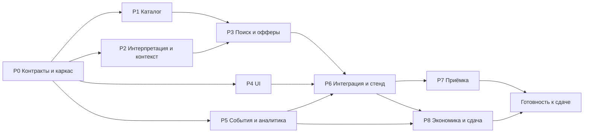

# План реализации и приёмки MVP

Версия 1.1 · 27.11.2026. Организатор перенёс окончательный срок приёма работ на **28 ноября 2026 года, 12:00 МСК**. Обновление имеет приоритет над прежними материалами. Пользователь разрешил начать реализацию. Публичное размещение и отправка материалов требуют отдельного согласования.

Основание: [ARCHITECTURE.md](ARCHITECTURE.md), [CONTRACTS.md](CONTRACTS.md), требования, регламент и уточнения пользователя к реализации.

## 1. Передача оркестратору

Решения, которые можно сразу реализовывать: один FastAPI-процесс; SQLite-каталог и отдельная runtime DB; нативный JS-интерфейс; FTS5 + fuzzy + роли + LLM; проверка конкретного оффера; отсутствие векторов; статические связи; структурированные события с первого инкремента; аналитика внутри того же приложения.

Исходные документы, включая появившийся в ходе работы `RESEARCH_REPORT.md`, прочитаны; его выводы сопоставлены с архитектурой. Проверки до окончательной фиксации первого инкремента:

| Проверка | Действие и влияние |
|---|---|
| Контрольные примеры отчёта | Зафиксировать в fixtures точные пары card/offer и основания из §8 RESEARCH_REPORT; проверить их через построенный индекс. Полный повторный анализ XML/донора не нужен |
| Runtime LLM | Проверить доступ к разрешённому аккаунту и модели `gpt-5.4-mini-2026-03-17` как стартовому кандидату. Реальным smoke проверить схему, русский ввод и usage; отдельно проверить timeout и настройку тарифа. При блокере продолжать независимую разработку и фиксировать незакрытую семантическую приёмку |
| Среда и сдача | Выбрать VM и локальный резерв; подготовить подтверждённый в отчёте комплект сдачи, проверить права публичного показа и ссылки. Непроверенными остаются закрытые Q&A и дополнительные условия личного кабинета |

При противоречии официальному первоисточнику адресно пересмотреть соответствующее решение и контракт. Согласованные уточнения к требованиям внесены в REQUIREMENTS.md. Остальные пункты для сверки перечислены в §8.

## 2. Инкременты и резерв времени

Отсчёт T0 начинается с фактического старта реализации. Плановая цель основной приёмки — 28 ноября, 08:30 МСК. Дополнительные два часа (08:30–10:30 МСК) отведены на качество поиска, регрессионное и интеграционное тестирование, проверку устойчивости стенда и подготовку материалов сдачи в согласованном объёме MVP. С 10:30 до 12:00 МСК остаётся 90 минут на финальные исправления, проверку ссылок и сдачу. Если T0 позже 27 ноября, 23:30 МСК, сократить необязательные работы и пересчитать план по фактическому прогрессу.

| Интервал от T0 | Результат |
|---|---|
| 0:00–0:30 | P0: общие схемы/fixtures, API-каркас, логирование запроса, LLM/FTS smoke, назначение областей записи |
| 0:30–2:30 | Параллельно импорт и интерпретация; оркестратор собирает search API и минимальный UI. К T+2:30 — G1: живой прямой **и функциональный** запрос, реальный оффер, trace, локальный/разрешённый стенд |
| 2:30–4:30 | Проверка лицензий, расширение кандидатов, reducer контекста, экспертные компоненты, связанные товары. Уже стартуют SQL-аналитика и черновик экономики |
| 4:30–6:30 | G2: весь обязательный поиск и бизнес-аналитика; заполненная первая версия калькулятора на реальном usage; UI и отказные сценарии |
| 6:30–8:00 | Отложенные перефразировки, интеграционные сценарии, исправления, репетиция демонстрации; материалы сдачи уже собраны |
| 8:00–9:00 | G3: фиксация воспроизводимой сборки, проверка холодного старта, ссылок и резервного запуска |

После T+2:30 нельзя заниматься только качеством retrieval, откладывая аналитику. Если план отстаёт, убрать автодополнение, расширенное обогащение, украшения trace и дополнительные графики; сохранить семантику, контекст, достоверность оффера, экспертный режим, обязательные бизнес-отчёты и экономику.

Зависимости означают готовность интеграции; код модулей можно начинать по fixtures сразу после P0. Путь до первого полезного ответа: P0 → P1/P2 → P3 → P6. Полный путь сдачи также включает P5, P7 и P8; аналитика не считается побочной задачей. Для G1 P3 сначала реализует только retrieve/verify/render на базовых условиях, пока P1/P2 завершают расширенные части; никакой пакет не должен ждать идеального завершения соседнего модуля.

## 3. Рабочие пакеты и владельцы файлов

Обозначения моделей соответствуют `ORCHESTRATOR.md`; это стартовые рекомендации, а не обещание доступности или относительной цены. Обычно одновременно не более двух субагентов плюс оркестратор. Grok доступен только после назначения пользователем; не считать его автоматически запущенным. В fallback его пакет получает освобождённый Sol/Terra.

| Пакет | Цель, зависимости | Единственная область записи | Модель / reasoning | Параллельность и критический путь |
|---|---|---|---|---|
| P0 | Зафиксировать контракт, окружение и skeleton; зависит от разрешения на реализацию | `contracts/**`, `api/**`, `service.py`, `runtime_schema.sql`, общие конфиги/зависимости/lock-файлы, OpenAPI и общие fixtures | Оркестратор GPT-6.2 Sol / high | Первым; критический |
| P1 | Подготовить реальный каталог, индексы, справочники, manifest; P0 | `catalog/**`, `taxonomy/**`, `tests/catalog/**`, новый `scripts/build_catalog.py`, собственные артефакты `data/catalog/**`, `data/enrichment/**` | GPT-6.2 Sol / medium; high для нормализации | Параллельно P2; критический к G1 |
| P2 | LLM-адаптер, интерпретация, expert plan и deterministic reducer; P0, краткая taxonomy от P1 | `interpretation/**`, `session/**`, `tests/interpretation/**`, `tests/session/**` | GPT-6.2 Astra / high | Параллельно P1; критический для семантики уже G1 |
| P3 | Retrieval, проверка оффера, ранжирование, related, сборка ответа; контракты P0, интеграционно P1/P2 | `search/**`, `response/**`, `tests/search/**`, `tests/response/**` | GPT-6.2 Sol / high | Начать по fixtures; после P1 на том же освобождённом слоте; критический |
| P4 | Поиск/диалог, группы карточек, trace и аналитические экраны; P0, endpoints по fixtures | `static/**`, `tests/ui/**` | Cursor/Grok по назначению пользователя; fallback GPT-6.1 Terra / medium | Независим от backend по fixtures; минимальный UI нужен к G1 |
| P5 | Durable events, usage, SQL-агрегаты и бизнес-рекомендации; P0, реальные события от первого G1 | `telemetry/**`, `analytics/**`, `tests/telemetry/**`, `tests/analytics/**` | GPT-6.1 Terra / medium; при сложной агрегации Sol / medium | Каркас telemetry делает оркестратор в P0, затем эксклюзивная передача P5; критический к G2 |
| P6 | Интеграция, deadlines, health/readiness, запуск и доступ к стенду; P1–P5 по частям | `api/**`, `service.py`, `runtime_schema.sql`, `deploy/**`, `.env.example`, общие конфиги; `RUNBOOK.md` после разрешения | Оркестратор GPT-6.2 Sol / high | Последовательная интеграция, ранний стенд; критический |
| P7 | Независимая приёмка, holdout, trace/метрики/стоимость; G1 для старта, G2 для завершения | `tests/acceptance/**`, `tests/fixtures/acceptance/**`, `artifacts/qa/**` | GPT-6.1 Terra / medium; критическое адресное ревью GPT-6.2 Astra / high | Параллельно доводке P3/P4; критический к G3 |
| P8 | Экономика, ограничения, лицензии, демонстрация, комплект сдачи; P0 для шаблонов, P5/P6 для фактов | `submission/**` | Cursor/Grok, если не занят P4; fallback Sol / medium | Начать с G1, черновик до G2; критический к сдаче |

В таблице пути `contracts/**` и другие пакеты относительны `src/smart_site_search/`, кроме явно указанных `tests/`, `scripts/`, `data/`, `deploy/`, `submission/`, `artifacts/` и корневых конфигов. Ни один исполнитель не редактирует существующие `AGENTS.md`, `ORCHESTRATOR.md`, `TZ.md`, `REQUIREMENTS.md` или донор. Изменение архитектурных документов, если потребуется, ведёт оркестратор после согласования изменения существующих файлов.

Telemetry имеет последовательную передачу: сначала оркестратор записывает минимальный emitter и структуру runtime DB, прекращает запись в `telemetry/**`, затем передаёт пакет P5. Владение `runtime_schema.sql` остаётся у оркестратора: P5 присылает требуемую миграцию текстом. Аналогично P4 владеет **всей** статикой, включая аналитическую страницу; P5 не редактирует UI. У P7 собственные acceptance fixtures; общие fixtures P0 он не меняет.

### Критерии готовности пакетов

| Пакет | Что должен предъявить исполнитель |
|---|---|
| P0 | Валидируемые схемы и fixtures; повтор request_id не запускает работу дважды; `/healthz`; event_received и terminal event связаны; FTS5 доступен; выбранный LLM прошёл реальный минимальный вызов либо доступ обозначен блокером семантической приёмки |
| P1 | Импорт из явно указанного файла; различены group/offer карточки; повторяющиеся param не потеряны; price=0 не бесплатный; контрольные счётчики объяснены; `group:121231` существует; готовый snapshot открывается повторно без LLM и импорта |
| P2 | Новая фраза о потребности превращается в роли/условия; изменения фильтров корректны; ссылки на карточки устойчивы; экспертный JSON валиден; отсутствуют товарные факты из LLM; timeout и невалидный ответ дают явную деградацию |
| P3 | Full требует одного оффера; подходящий оффер не теряется за первым LIMIT; расширение 24→72→200 работает; exclude не ослабляется; related отделены; неизвестное условие не становится full; лимит поиска видим |
| P4 | Реальный ответ API отображён по трём группам; цена, оговорки и дата фида понятны; фильтр можно снять; диалог и ссылки работают; события показа/клика отправлены; технические поля не мешают пользователю |
| P5 | События и usage не теряются при последующей ошибке; mock отделены; SQL-метрики имеют определения и знаменатели; related-only не меняет primary_outcome; стоимость с неизвестным usage не ноль |
| P6 | Один документированный запуск; persistent volumes; live semantic smoke на стенде; trace доступен; restart не вызывает импорт/обогащение; понятна fallback-ветка без ключа; публичность соответствует разрешению |
| P7 | Пройденная матрица ниже с доказательствами либо явный список блокеров; сохранены версия каталога/кода/модели, seed holdout, результаты; нет заявлений об измеренном uplift |
| P8 | Калькулятор организатора заполнен на замерах, источники тарифов/курса/допущения указаны; инструкция демо; список моделей/библиотек/лицензий и ограничений; комплект готов для проверки разрешённых внешних ссылок |

### Расписание исполнителей без скрытой мощности

1. P0 выполняет оркестратор. Далее слот 1 — P1/Sol, слот 2 — P2/Astra. Оркестратор пишет координатор и минимальный UI только если P4 ещё никому не передан; после передачи `static/**` запись прекращает.
2. Если пользователь подключил Grok, тот получает P4 с готовыми fixtures. Иначе после ранней версии P1 слот 1 последовательно выполняет P3, а после ранней версии P2 слот 2 — P4 или P5; оркестратор берёт оставшийся небольшой пакет до эксклюзивной передачи. Одновременное владение недопустимо.
3. P5 разворачивается сразу после G1; P8 начинает подготовку шаблона и описания в этот же период. Нельзя ждать завершения всех улучшений P3.
4. Освободившийся слот получает P7; исправления он сообщает владельцу модуля. Адресное Astra-ревью критических инвариантов идёт после завершения P2, без повторного полного чтения проекта.
5. Если Grok отсутствует, длительности остаются бюджетом, требующим перепланирования по фактическому прогрессу; нельзя выдавать диаграмму логических зависимостей за реально доступную неограниченную параллельность.

Общие dependency/lock/schema-конфиги всегда изменяет только оркестратор. Исполнители возвращают запрос на зависимость или поле контракта; оркестратор последовательно обновляет и уведомляет потребителей. Нельзя параллельно устанавливать зависимости в общее окружение или запускать два импортера в один каталог. Интеграционный запуск использует отдельную runtime DB от модульных тестов. Ни один агент не делает commit/push/reset за другого.

## 4. Первый сквозной инкремент G1

Локальная проверка на 27 ноября: реальный снимок содержит 12 538 карточек и 136 040 офферов. API вернул `group:121231` с конкретным оффером без LLM, функциональную выдачу из восьми карточек через YandexGPT Pro 5.1 и экспертную выдачу с четырьмя частично покрытыми компонентами. Для живых вызовов получены usage и стоимость по тарифу с НДС. Uvicorn, страницы поиска и аналитики, статические ресурсы и OpenAPI проверены по loopback. Проверка с другого устройства, публичный стенд и полный комплект сдачи ещё открыты.

G1 — не только обычный поиск по строке. Минимум:

1. Реальный snapshot каталога с проверенной карточкой Astra и классами; маленькие синтетические fixtures остаются в тестах.
2. UI → API → direct поиск → `group:121231` → реальный оффер и ссылка → события → trace.
3. UI → новая функциональная реплика → **реальный внешний LLM** → роль/термины → реальные карточки → оговорки и вопрос.
4. Один контекстный фильтр, базовая тристатусная проверка оффера, fallback модели, durable usage.
5. Локально или в уже разрешённой среде поднят тот же контейнер/процесс, который будет использован на защите. Проверено открытие с другого браузера/устройства в разрешённой сети.

Экспертная глубина, расширение всей аналитики и стилистическая доводка идут после G1, но контракты и события для них уже присутствуют. Если семантика не работает, G1 не называется завершённым.

## 5. Приёмка продукта

Фактические статусы F01–F13, результаты независимых аудитов, исправления и оставшиеся проверки ведутся в [отчёте приёмки](artifacts/qa/acceptance.md). Локальный калькулятор и сценарий записи подготовлены в `submission/`. Публичное размещение и подача работ требуют отдельного разрешения.

### Источник эталонов

Из `TZ.md`: Astra Linux Special Edition — `group:121231`, полка `222320`, 803 оффера в описанном snapshot; это одна карточка. Из `RESEARCH_REPORT.md §1`: восемь smoke-целей ведут на товар, «кибер бэкап» — на отфильтрованную витрину вендора, «мтс» — в `/webinar/`; содержимое этих страниц при исследовании не было проверено. Формат навигационного результата остаётся открытым вопросом.

Офферные эталоны ниже взяты из [RESEARCH_REPORT.md, §8](RESEARCH_REPORT.md#8-проверяемые-сценарии). До P7 интегратор проверяет их через готовый lookup и фиксирует source refs, не исследуя фид заново. Цены и наличие — факты предоставленного snapshot, а не текущего магазина.

| ID | Вход и точные данные из отчёта | Обязательное поведение |
|---|---|---|
| R01 | «alt server 11 x86, бессрочно»: `group:408335`, оффер `495106`, 15 180 ₽, available=true; x86_64 и бессрочность указаны в названии | Полный прямой результат при подтверждении всех условий; source refs на name, price, available. Цена в API 1518000 копеек |
| R02 | «касперсикй, антивирь на 50 компов» → «обязательно ФСТЭК»: `group:4052`, `222175`, 2 370,60 ₽, available=true, партия 50–99, полная электронная лицензия на 12 месяцев для коммерческого юрлица | При уточнении ФСТЭК unknown, карточка не full по сертификату. Цена оффера 237060 копеек, не цена всех 50 лицензий; итог партии только при подтверждённой единице продажи |
| R03 | «Хочу восстанавливать виртуалки после сбоя» → «на год для юрлица»: оффер `536457`, 664 ₽, назначение ВМ, бессрочный срок, категория пользователя неизвестна | Функциональный поиск находит кандидата; после уточнения срок mismatch, customer_type unknown, карточка partial. Card_id получить по связи этого offer_id, не выдумывать |
| R04 | «Кибер Бэкап для платформы виртуализации, коммерческому юрлицу, электронная бессрочная лицензия до 90 тысяч» → «подними до 110 тысяч»: у `group:173614` 48 офферов; коммерческий `421468` доступен за 103 236 ₽, академический `530597` доступен за 87 757 ₽ | При 90 000 ₽ у этой карточки нет полного соответствия; нельзя соединить цену академической лицензии с коммерческими условиями. При 110 000 ₽ выбрать `421468`, цена 10323600 копеек; остальные фильтры сохранены |
| R05 | «Стойковый INFERIT RS212 и что к нему докупить»: hardware `offer:542026`, available=true; кандидаты дополнений — ОС `495106`, виртуализация `496948`, ИБП `82106` | Основной сервер и отдельные related после проверки направленных связей; не заявлять совместимость. «Ещё без вендора второй карточки» → «теперь ноутбук» проверяет сохранённый порядок, исключение и смену темы. Related card_id ПО разрешается через offer lookup |
| R06 | «Локальная LLM для сотрудников, доступный GPU от 48 ГБ»: у сервера `542026` GPU-состав не подтверждён; доступная RTX 3060 `403360` имеет 12 ГБ; L40S `460944`, A100 `463253`, H200 NVL `505481` недоступны, price=0 | RTX 3060 — mismatch по памяти, остальные — по наличию и unknown цены. Сервер не подтверждает GPU. Нет полного кандидата **в проверенной выборке**; экспертный план сохраняет partial/missing и вопрос о модели/нагрузке |

R01–R06 — smoke/regression на фактических данных, не весь benchmark. Особый классификационный негатив: ROSA Dynamic Directory на полке «Российская виртуализация» не получает подтверждённую роль hypervisor только из названия полки (§2 отчёта).

| ID | Сценарий | Проверяемый результат |
|---|---|---|
| A01 | `Astra Linux Special Edition`, `астра линукс` | Первая основная карточка `group:121231`; не полка `222320`, не 803 лицензии; цена/URL соответствуют выбранному offer_id |
| A02 | Опечатка/раскладка/транслитерация для реального имени Astra, AnyDesk или Kaspersky | Ожидаемая карточка в top-3; исходная реплика сохранена; исправление видимо; цифры версии не изменены fuzzy |
| A03 | `антивирь на 50 компов`, неоднозначное сокращение `СЗИ` | Роль защиты распознана, devices/users не смешаны; количество не превращается в выдуманный total; при неоднозначности — вопрос |
| A04 | Новое описание «вернуть рабочую среду после потери файлов», без названия продукта | Реальный LLM mapping к резервному копированию/восстановлению; релевантная карточка в top-3 либо честная неподтверждённость функции; не точное совпадение заранее записанной фразы |
| A05 | `сервер`, затем `именно ПО для сервера` | Первый ответ разделяет возможные смыслы и задаёт вопрос; второй не показывает оборудование как основной full; широкая полка «Серверное ПО» не выдаётся целиком |
| A06 | Реальный software-запрос → `на год для юрлица` → `на два года` → `срок неважен` | Наследование релевантных полей, set заменяет 12 на 24, remove снимает срок; остальные условия сохранены |
| A07 | `второй вариант`, `ещё без этого вендора`, затем `теперь ноутбук` | Ссылка разрешена по конкретному предыдущему request; исключённый вендор не возвращается; more убирает показанные карточки; смена темы сбрасывает лицензии и локальные запреты |
| A08 | Контрпример R04: коммерческое юрлицо и бюджет 90 тысяч у `group:173614` | Ни один full не собран из двух офферов; partial имеет конкретного свидетеля и причины; после повышения до 110 тысяч `421468` становится full |
| A09 | Подтверждённая лицензия и соседняя с unknown/mismatch условия | Full выше partial; цена именно подходящего варианта; неизвестный сертификат/платформа не считается совпадением |
| A10 | Цена 0, непонятная партия, неполная аппаратная характеристика | «По запросу»/«нет данных», не бесплатно; total=null без основания; оборудование проверяется как один оффер |
| A11 | Контрольная подходящая карточка за пределами первых 24 кандидатов | Расширение находит full, не останавливается на related-доборе; лимит 200/таймаут даёт search_truncated и запрещает вывод о полном отсутствии |
| A12 | R06 и новая перефразировка локальной LLM с доступным GPU от 48 ГБ | Внешняя модель формирует ограниченный план; по компонентам показаны реальные карточки, partial/missing и неизвестные параметры; 12 ГБ или недоступный GPU не становится full; нет обещания совместимости |
| A13 | R05: `542026` и проверенные связи к ОС `495106`, виртуализации `496948`, ИБП `82106` | Только существующие направленные связи; related отделены, условия применены по scope; нет «часто покупают вместе» без данных |
| A14 | Штатный широкий запрос с достаточным числом релевантных/связанных карточек | Не менее 4 уникальных товаров и понятные группы; четыре лицензии одного продукта не считаются четырьмя товарами |
| A15 | Несуществующий продукт, невозможная комбинация, только related | Нет случайного добора; primary_outcome none/partial/undetermined соответствует причине; минимум 4 честно недостигнут при отсутствии оснований |
| A16 | Цели `кибер бэкап` и `мтс` из выборки | Линейка backup проверяется по реальным карточкам; webinar-ссылка не объявляется товаром. Если навигация вне каталога не реализована, ограничение явно показано; не фабриковать соответствие |
| A17 | LLM timeout, 429, 401, invalid JSON, неизвестный role_id, prompt injection в тексте | Нет исполнения невалидного плана; bounded retries; прямой поиск доступен; новая экспертная задача честно degraded; непонятые условия не исчезают |
| A18 | Просмотр trace прямого и экспертного запроса | Все stages с общим request/session id; решения и офферные основания видимы; нет chain-of-thought/ключей; каждый фактический вызов учтён |
| A19 | Синтетический набор событий и реальные демо-клики | Mock-разрез отделён; related не повышает full; дубликаты не удваивают метрики; denominator раскрыт; без заказов реальная конверсия unavailable |
| A20 | 0 LLM calls, 1 call, экспертные 2 calls, retry, cache hit и missing usage | Стоимость сверяется с формулой и тарифом; output/reasoning не удвоены; неизвестный расход не ноль; подготовка/разработка отделены |
| A21 | Дубликат request, параллельные реплики одной сессии, restart | Idempotency без повторного LLM; 409 для конфликта; сохранённый результат/сессия восстановлены; interrupted попытка остаётся в расходах |
| A22 | Холодный старт разрешённого стенда и локального резерва | Каталог готов без повторной подготовки; поиск, контекст, экспертный запрос, аналитика и trace работают; публичные ссылки проверяются только после разрешённого размещения |

A08 может использовать два набора: найденный реальный контрпример и небольшой синтетический unit-fixture, чтобы инвариант не зависел от изменений каталога. Синтетический пример не выдаётся за реальную комбинацию из feed.

### Качество без подгонки

Перед основной доводкой P7 сохраняет отдельный holdout: минимум 12 новых функциональных перефразировок по 4 разным потребностям, 6 шумных названий и 6 контекстных последовательностей. Автор/исполнитель P2/P3 не получает точные фразы до фиксации базовой версии; роли и критерии релевантности известны. Близкие варианты одной исходной потребности держать в одной группе при разделении tuning/holdout, как рекомендует §8 отчёта. При раскрытии и исправлении по конкретному примеру вся группа переносится в regression, а holdout заменяется новой группой.

Инженерный порог для демонстрации: минимум 10 из 12 функциональных фраз имеют обоснованный основной кандидат в top-3; минимум 5 из 6 шумных названий исправлены; все 6 контекстных цепочек сохраняют/снимают условия правильно. Это внутренний quality gate, не критерий организатора. Ноль вымышленных товаров/цен/подтверждений совместимости, ноль false-full в контрольных офферных сценариях. Регрессии достоверности не компенсируются высоким recall.

Локальные целевые задержки на прогретом стенде: direct без LLM p95 ≤ 2 с, functional ≤ 12 с, expert ≤ 25 с на серии минимум 20 запросов с указанием числа запросов каждого режима. Если мало измерений, публиковать наблюдаемые значения и размер выборки, не устойчивый SLA. Bounded fallback ≤ общего deadline плюс небольшие накладные расходы. Эти цели не измерены на этапе архитектуры.

Проверки ограничиваются затронутыми модулями, контрактными и сквозными сценариями. После успешной приёмки без изменений не повторять всё многократно. Артефакт P7: таблица pass/fail, команды, версия каталога/модели/кода, известные ограничения; без копирования полного feed и пользовательских данных.

## 6. Бизнес-аналитика и сдача как обязательный результат

До T+4:30 P5 должен показать хотя бы один SQL-отчёт на событиях G1, а P8 — открытую структуру калькулятора и список необходимых замеров. До T+6:30 — все шесть отчётов из ARCHITECTURE.md и первая заполненная экономика. Оформление сдачи не ждёт идеального UI.

Пакет P8 готовит в `submission/`:

- Заполненную **копию** исходного калькулятора организатора. По §7 отчёта на листе «Расчёт», A2:I16, для каждого шага нужны вызовы/запрос, input/output tokens, тариф за миллион и валюта; итог в рублях без НДС, USD — по курсу ЦБ РФ на 26.11.2026. Структура и формулы при архитектуре повторно не исследовались: P8 сохраняет шаблон и проверяет расчёты. Для своей модели шаблон допускает нулевую цену токенов с расходами сервера в комментарии; наш выбранный внешний API имеет ненулевой тариф.
- Раздельные измерения direct/functional/expert, частоты cache hit, известных и неизвестных расходов; отдельные расходы подготовки, инфраструктуры и разработки. Экстраполяция на 500 запросов/сутки — сценарий с указанной смесью режимов.
- Краткое описание стека, модели и версии, сторонних библиотек/API и лицензий; donor=REFERENCE, без перенесённого кода.
- Демонстрационное **видео до трёх минут одним фрагментом**, как требуется по §1 отчёта. План: 0:00–0:25 прямой поиск; 0:25–0:55 новая функциональная фраза; 0:55–1:25 контекст и R04; 1:25–2:00 expert/R06; 2:00–2:25 trace и стоимость; 2:25–2:55 аналитика и ограничения. В кадре видно происхождение mock-метрик и неполное покрытие. Репетицию и черновую запись сделать до G3.
- Описание продукта, подготовленный публичный репозиторий с осмысленной историей коммитов, URL отдельного работающего стенда, ссылку на калькулятор без авторизации; это подтверждённый комплект для личного кабинета (§1 отчёта, положение п.4.5). Git-операции и публикация выполняются только в разрешённом объёме; один финальный архив не заменяет требуемую историю. Презентация не объявляется обязательной без дополнительного условия.
- Инструкцию запуска, ограничений и восстановления. Дополнительные условия личного кабинета/закрытые Q&A проверить отдельно, так как исследовательский отчёт их не сверял.

Публикация, отправка организаторам и открытые ссылки сейчас не разрешены. После подготовки конкретного проверяемого комплекта получить разрешение пользователя на необходимые внешние действия и проверить анонимный доступ к калькулятору/репозиторию и доступность стенда. Полный исходный feed, private-секреты и донорский код не включать в публичный пакет по умолчанию. Пакет поставки содержит только разрешённый код, инструкцию приватного подключения feed и помеченные синтетические fixtures. Не обещать «проект сдан», пока фактическая передача не выполнена.

По §1 отчёта финал оценивает шесть равновесных направлений: соответствие задаче, техническая корректность, потенциал внедрения, готовность, агентность, экономика. Наши доказательства соответственно: A01–A16; офферные source refs/тесты; обычный HTTP API и веб-интерфейс для будущего встраивания; работающий стенд; план expert→каталог→проверка; замеры в калькуляторе. Отдельный SDK и реальная интеграция с магазином для защиты не требуются.

## 7. Риски и решения при отклонениях

| Риск | Наблюдаемый сигнал | Действие |
|---|---|---|
| Новое разъяснение меняет правила | Дополнение организатора в Q&A/личном кабинете | Точечная поправка контракта/приёмки оркестратором; не повторять завершённое исследование |
| Нет доступной runtime LLM | Не пройден P0 smoke | Проверить разрешённый доступ/ключ; заменить только адаптер после фиксации доступного провайдера. Продолжать каталог/UI/логи, не объявлять semantic MVP готовым |
| Словаря ролей недостаточно | Провал новых функциональных фраз | Дополнить роли и mapping на уровне понятий, пакетно проверить неоднозначные карточки; не hardcode запросы и не запускать массовое обогащение офферов |
| Фильтры уничтожают полноту | Подходящий оффер есть за первым кандидатом | Расширить карточный пул, проверить SQL-свидетеля по всем офферам карточки; не удалять фильтры |
| Много unknown | Partial преобладает при понятной потребности | Показывать ограничения и отчёт контент-менеджеру; не заполнять факты знаниями LLM |
| Не хватает времени | G1 позже T+2:30 или G2 позже T+6:30 | Убрать бонусы и косметику, завершать обязательные пакеты; не переносить аналитику/экономику на последние минуты |
| Внешний стенд недоступен | Нет VM/сети/разрешения | Проверенный локальный запуск и готовый deployment bundle; публичный URL остаётся отдельным блокером сдачи |
| Конфликт файлов исполнителей | Запрошен общий конфиг/контракт | Только оркестратор изменяет общий файл, последовательно уведомляет потребителей; не откатывать чужую работу |

## 8. Сверка REQUIREMENTS.md

Согласованные уточнения применены при старте реализации. Таблица сохраняет соответствие разделов требованиям и контрактам.

| Раздел | Предлагаемое уточнение |
|---|---|
| §1 и §7 | Исследование завершено. Зафиксированы источники, согласованные уточнения и дедлайн 28.11.2026, 12:00 МСК. Комплект сдачи приведён в §1 отчёта, закрытые Q&A остаются непроверенными |
| §2 | Сохранить SoftwareCard/HardwareCard и проверку комбинации на оффере; дополнить provenance, conflicting/unknown, различие domestic_hint/реестра, единицы продажи и цену 0. Уточнить: полка не доказывает роль (ROSA Dynamic Directory), старый JSONL опускает param/sales_notes, реальные popularity/margin/события не предоставлены |
| F01 и F07 | Семантическое понимание обязательно с первого инкремента; роли/обогащение и LLM-интерпретация приняты, embeddings остаются инженерной опцией. Нельзя ограничивать понимание фиксированными фразами |
| F02 | Уточнить операции set/remove/clear_scope, ссылки на сохранённый порядок ответа, more/exclude, сброс topic-фильтров и явные session-ограничения |
| F03 | Три состояния условия; full доказывается одним оффером, partial виден отдельно; exclude не ослабляется. Неизвестные условия не отбрасываются молча |
| F04 | Указать официальный минимум 4 товара в штатном сценарии и согласованную пользователем честную выдачу меньшего числа при отсутствии обоснованных кандидатов; оставить это ограничением, не объявлять подтверждённым исключением организаторов |
| F05–F06 | Статические направленные связи и отдельная группа related; экспертный план → поиск компонентов → verified response; знания LLM не подтверждают совместимость; прописать деградацию |
| F08–F09 | События/usage с первого инкремента, аналитика обязательна во втором; primary_outcome независимо от related; раздельные флаги mock-каталога/поведения/бизнес-факторов и точные знаменатели |
| F11 | Зафиксировать видео до 3 минут одним фрагментом, описание, публичный repo с историей, URL стенда и открытый калькулятор; рубли без НДС, курс ЦБ 26.11.2026. Расчёт по фактическим попыткам, unknown usage не ноль; runtime/подготовка/разработка отдельно; подготовка начинается после G1 |
| F12 | Full/partial и релевантность выше цены и бизнес-сигналов; популярность/маржа только подтверждённые или явно mock, отсутствие нейтрально |
| F13 | Закрыть открытый вопрос: автодополнение — бонус по PDF, подтверждено §1 отчёта и пользователем; исправления и предложения остаются обязательной частью ответа |
| §4–6 | Заменить незавершённые исследования принятыми решениями и планом реализации; добавить R01–R06 из отчёта, проверки расширения выборки, unknown, дедупликации расходов, fallback, стенда и holdout |

Отдельно отметить несовпадения инженерных предложений старого TZ с выбранным решением: unified offers для оборудования, ограниченное адаптивное расширение вместо фиксированных 10–20 карточек, immutable snapshot/cache вместо дорогой пересборки на старте. TZ не редактировать и не выдавать эти предложения за новые требования заказчика.

## 9. Условия завершения

Архитектурный пакет позволяет начать независимую реализацию по зафиксированным контрактам; все семь запрошенных источников прочитаны. Обратимые допущения: доступ к выбранной runtime-модели, среда стенда, стартовые пороги retrieval/latency и ограниченный объём обогащения. Их проверки включены в P0/G1, а не оставлены неназначенными вопросами.

Продукт готов к сдаче только после G3: обязательная матрица пройдена, live семантика и expert работают, факты подкреплены офферами, аналитика и экономика воспроизводимы, стенд доступен в требуемом формате, ограничения и mock явно показаны, необходимые разрешения и внешние ссылки проверены. Наличие кода/документов без этих проверок не считается готовым MVP.
